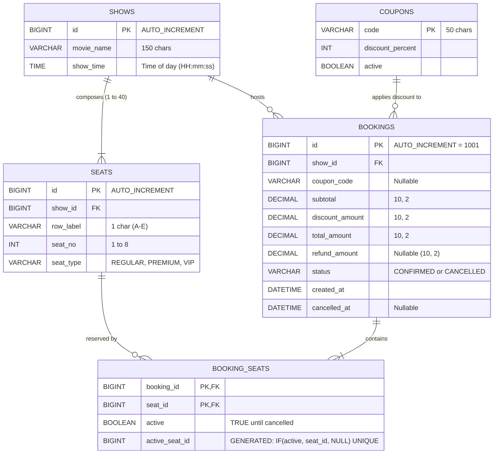

# CineBook - Single-Screen Cinema Ticket Booking Web Application

CineBook is a full-stack web application designed for a single-screen cinema auditorium. Customers can view upcoming daily showtimes, inspect a live 5 × 8 interactive seat map, choose seats across **Regular**, **Premium**, and **VIP** rows, apply promotional discount coupons, and receive comprehensive booking summaries. Customers can also lookup their bookings and cancel reservations for an automated 80% refund.

This project is the enterprise web edition of an earlier console-based cinema project. It preserves and enhances the object-oriented design (OOP) of the original while replacing in-memory state with a persistent **MySQL 8.0+** database managed via **MySQL Workbench** and **Flyway migrations**.

---

## Architecture & Technology Stack

- **Backend**: Java 17+, Spring Boot 3.3.5 (Spring MVC, Spring Data JPA, Bean Validation)
- **Database**: MySQL 8.0+ (InnoDB, UTF-8 `utf8mb4_unicode_ci`)
- **Connection Pool**: HikariCP (configured with `maximum-pool-size=5`)
- **Schema Management**: Flyway (`flyway-core` + `flyway-mysql`)
- **JPA / Hibernate Validation**: `spring.jpa.hibernate.ddl-auto=validate` and `spring.jpa.open-in-view=false`
- **Frontend**: Thymeleaf, semantic HTML5, modern CSS3 ("Vintage Picture Palace" art-deco light theme), vanilla JavaScript (zero CDN dependencies, no npm, no React, no build step)
- **Testing**: JUnit 5, Mockito, Spring MockMvc (54 automated tests, runs without needing a live database)

---

## UI Design: Vintage Picture Palace (1950s Art-Deco Cinema)

CineBook features an authentic **1950s Art-Deco Picture Palace** light design theme, evoking the golden age of single-screen cinema:

- **Theme Name**: *Vintage Picture Palace*
- **Aesthetic**: Warm aged cream paper (`#f6efe1`) with subtle CSS-only paper grain, framed by velvet curtain swags (`#8c1c2b`), double brass borders (`#b8872b`), and a grand marquee sign with gentle blinking incandescent bulbs.
- **Color Palette**:
  - **Cream Paper Base**: `--paper-cream: #f6efe1;`, `--paper-card: #fcf9f2;`
  - **Deep Ink Text**: `--ink-dark: #2b1d14;`, `--ink-subtle: #594235;`
  - **Velvet Curtains & Accents**: `--velvet-red: #8c1c2b;`, `--velvet-red-dark: #63111d;`
  - **Polished Brass / Gold**: `--brass-gold: #b8872b;`, `--brass-gold-light: #d8a548;`
  - **Forest Green (Success / Rubber Stamp)**: `--forest-green: #2f6b4f;`
  - **Seat Tiers**:
    - **Regular (Rows A–B)**: Muted Teal-Green Velvet (`#2a6f67`, background `#e6f0ee`)
    - **Premium (Rows C–D)**: Deep Burgundy Velvet (`#7a1b2a`, background `#f5e8ea`)
    - **VIP Lounge (Row E)**: Polished Brass-Gold Velvet (`#b8872b`, background `#faf2e1`)
- **Typography (System Stacks Only — Zero Runtime CDN Calls)**:
  - **Display / Headings**: `Georgia, "Palatino Linotype", "Book Antiqua", Palatino, "Times New Roman", serif;`
  - **Body / Sans**: `system-ui, -apple-system, "Segoe UI", Roboto, Helvetica, Arial, sans-serif;`
  - **Monospace / Stamps & Codes**: `ui-monospace, "SF Mono", "Cascadia Code", "Roboto Mono", Consolas, monospace;`
- **Zero External Network Dependencies**:
  - No Google Fonts, no external CDNs, no remote images.
  - Custom inline SVG favicon and CSS-only ornamental patterns.
- **How to Customize the Palette via CSS Variables (`:root`)**:
  All visual tokens are declared at the top of [`src/main/resources/static/css/main.css`](file:///c:/Users/Admin/OneDrive/Desktop/judei/src/main/resources/static/css/main.css#L7-L50). To adjust the cinema aesthetic or swap palettes, modify the variables under `:root`:
  ```css
  :root {
      --paper-cream: #f6efe1;         /* Main canvas background */
      --velvet-red: #8c1c2b;          /* Primary action & curtain red */
      --brass-gold: #b8872b;          /* Art-deco ornamental borders */
      --tier-regular-border: #2a6f67; /* Teal for Regular seats */
      --tier-premium-border: #7a1b2a; /* Burgundy for Premium seats */
      --tier-vip-border: #b8872b;     /* Gold for VIP seats */
  }
  ```

---

## Functional Requirements (FR-1 to FR-8)

| Feature Code | Priority | Description | Implementation Details |
| :--- | :--- | :--- | :--- |
| **FR-1** | Must | Home page listing at least 3 shows | Displays "Interstellar (7:30 PM)", "Inception (4:00 PM)", and "The Dark Knight (10:00 PM)" with seat availability counts. |
| **FR-2** | Must | Live 5 × 8 seat grid (Rows A–E, Seats 1–8) | Interactive grid with screen bar: Available seats are green (O), Booked seats are red (X), and Selected seats are highlighted gold (✓). |
| **FR-3** | Must | Strict tier pricing from `SeatType` enum | Rows A–B = `REGULAR` (Rs. 150), C–D = `PREMIUM` (Rs. 250), E = `VIP` (Rs. 400). Prices are defined *only* in `SeatType.getPrice()` and never hardcoded in SQL, HTML, or JavaScript. |
| **FR-4** | Must | All-or-nothing transactional booking | Validates seat codes against regex `^[A-E][1-8]$`, trims whitespace, rejects duplicates and taken seats. Pessimistic write lock ensures no double-booking. If any selected seat is taken, zero seats are booked. |
| **FR-5** | Must | Auto-generated booking summary receipt | Generates booking ID starting at `BK1001` via MySQL `AUTO_INCREMENT`. Displays movie title, showtime, formatted seat breakdown with tiers, subtotal, discount, and net total. |
| **FR-6** | Should | Case-insensitive coupon discounts | Handled via method overloading in `PricingService`. Database-seeded `CINE10` provides a 10% discount. Invalid or expired coupons show a friendly banner without blocking the reservation. |
| **FR-7** | Should | Booking cancellation with 80% refund | Cancels booking, frees associated seats, stamps `cancelled_at`, and refunds exactly 80% of total paid (`REFUND_PERCENT = 80`). Cancelling an already cancelled booking is rejected. |
| **FR-8** | Should | Independent show seat grids | Each show maintains an isolated 40-seat inventory. Booking C3 in Show 1 does not affect C3 in Show 2. |

---

## Design Evolution: Console vs. Web Architecture

> [!NOTE]
> **Architectural Note on Console vs. Web Version**:
> The original console assignment required using a pure 2D array and a static counter while strictly forbidding external databases and graphic user interfaces. This web edition intentionally elevates those requirements into a production-grade full-stack architecture by connecting MySQL and a responsive Thymeleaf web interface, while keeping the core OOP paradigms (2D array manipulation, interfaces, composition, method overloading, and domain exceptions) at the center of the application logic.

### Concepts Used: Mapping from Original Assignment to Implementation

| Assignment Concept | Location in CineBook Codebase | Implementation Details |
| :--- | :--- | :--- |
| **2D Array & Nested Loops** | [`Show.buildSeatGrid()`](file:///c:/Users/Admin/OneDrive/Desktop/judei/src/main/java/com/cinebook/model/Show.java) & [`BookingService.java`](file:///c:/Users/Admin/OneDrive/Desktop/judei/src/main/java/com/cinebook/service/BookingService.java) | `Seat[5][8]` 2D array built using nested loops across rows (0..4) and columns (0..7). Drives visual rendering on the seat map page and validates seat existence. |
| **Enum with Fields & Getters** | [`SeatType.java`](file:///c:/Users/Admin/OneDrive/Desktop/judei/src/main/java/com/cinebook/model/SeatType.java) | `REGULAR(150)`, `PREMIUM(250)`, `VIP(400)` with `int price` field, `getPrice()` getter, and `fromRowLabel(row)` row-mapping factory method. |
| **Interface** | [`Bookable.java`](file:///c:/Users/Admin/OneDrive/Desktop/judei/src/main/java/com/cinebook/service/Bookable.java) | Defines contract `bookSeats(...)` and `cancelBooking(...)`, implemented by `BookingService`. |
| **Composition & Facade** | [`Theatre.java`](file:///c:/Users/Admin/OneDrive/Desktop/judei/src/main/java/com/cinebook/service/Theatre.java) | `Theatre` service facade composes shows and all bookings; `Show` composes its collection of `Seat` entities. |
| **Method Overloading** | [`PricingService.java`](file:///c:/Users/Admin/OneDrive/Desktop/judei/src/main/java/com/cinebook/service/PricingService.java) | `calculateTotal(List<Seat>)` and `calculateTotal(List<Seat>, String couponCode)` providing flexible pricing computation. |
| **Booking ID Generator** | [`Booking.java`](file:///c:/Users/Admin/OneDrive/Desktop/judei/src/main/java/com/cinebook/model/Booking.java) & `V1__init.sql` | Replaces the original in-memory static counter with MySQL `AUTO_INCREMENT=1001`. Formatted as `BK1001`, `BK1002`, etc. |
| **Seat Code Validation** | [`BookingService.normalizeAndValidateSeatCodes()`](file:///c:/Users/Admin/OneDrive/Desktop/judei/src/main/java/com/cinebook/service/BookingService.java) | Validates seat input format `^[A-E][1-8]$`, trims whitespace, checks for duplicate selections, and verifies against the 2D grid. |
| **Collections / List Usage** | `com.cinebook.service.*` | `ArrayList`, `List`, `Set`, and `Map` collections used throughout domain layers for robust data handling. |

---

## Entity-Relationship (ER) Diagram



> [!TIP]
> **Database-Enforced Anti-Double-Booking**:
> In `booking_seats`, the stored generated column `active_seat_id BIGINT GENERATED ALWAYS AS (IF(active, seat_id, NULL)) STORED` has a `UNIQUE KEY`. When a booking is active, `active_seat_id` holds the seat ID. When cancelled, it evaluates to `NULL` (which allows duplicates in MySQL unique constraints), automatically releasing the seat for future reservations.

---

## Prerequisites

1. **Java 17+** (JDK 17 or JDK 21 installed and verified via `java -version` and `javac -version`)
2. **Apache Maven 3.8+** (verified via `mvn -version`)
3. **MySQL Server 8.0+** (running locally on port `3306`)
4. **MySQL Workbench 8.0+** (for schema inspection and running utility queries)

---

## MySQL Setup & Configuration

### 1. Configure `.env` File
Create a `.env` file in the project root by copying `.env.example`:

**Windows (PowerShell or CMD)**:
```powershell
copy .env.example .env
```

**macOS / Linux**:
```bash
cp .env.example .env
```

Edit `.env` with your MySQL credentials:
```properties
MYSQL_HOST=localhost
MYSQL_PORT=3306
MYSQL_DB=cinebook
MYSQL_USER=root
MYSQL_PASSWORD=your_actual_mysql_password
```

### 2. Database Creation & Schema
You do **not** need to manually create tables; Spring Boot runs Flyway migrations (`V1__init.sql` and `V2__seed.sql`) automatically on startup, initializing:
- All 5 tables and foreign keys
- Generated column and unique constraint on active bookings
- Seed data for 3 shows (Interstellar, Inception, The Dark Knight)
- 120 seats (40 per show across Regular, Premium, VIP)
- Promotional coupon `CINE10` (10% discount)

---

## How to Run the Application

### Option A: Using the Convenience Scripts (Recommended)

**Windows**:
Double-click or run from PowerShell/CMD:
```powershell
.\run.bat
```

**macOS / Linux**:
Make executable and run:
```bash
chmod +x run.sh
./run.sh
```

### Option B: Using Maven Directly

**Windows (PowerShell)**:
```powershell
$env:MYSQL_PASSWORD="your_mysql_password"
mvn spring-boot:run
```

**Windows (CMD)**:
```cmd
set MYSQL_PASSWORD=your_mysql_password
mvn spring-boot:run
```

**macOS / Linux**:
```bash
export MYSQL_PASSWORD="your_mysql_password"
mvn spring-boot:run
```

Once started, open your web browser at:
👉 **`http://localhost:8080`**

Health check endpoint:
👉 **`http://localhost:8080/health`** (returns `"OK"`)

---

## How to Run Automated Tests

The test suite runs 54 unit and sliced web tests with Mockito and MockMvc without needing a running database:

```bash
mvn clean test
```

To package the runnable executable JAR:
```bash
mvn clean package
```
The resulting JAR is created at `target/cinebook-1.0.0.jar`.

---

## Inspecting Data in MySQL Workbench

1. Open **MySQL Workbench** and connect to your local MySQL instance (`localhost:3306`).
2. In the **Schemas** tab on the left, right-click and choose **Refresh All**. The `cinebook` schema will appear.
3. Expand `cinebook > Tables` to view:
   - `shows`
   - `seats`
   - `bookings`
   - `booking_seats`
   - `coupons`
4. Right-click on any table and select **Select Rows - Limit 1000** to inspect live records.

### Standalone SQL Files in `database/`
- [`database/cinebook_schema.sql`](file:///c:/Users/Admin/OneDrive/Desktop/judei/database/cinebook_schema.sql): Full DDL + DML script if you wish to initialize the database manually inside Workbench rather than via Flyway.
- [`database/useful_queries.sql`](file:///c:/Users/Admin/OneDrive/Desktop/judei/database/useful_queries.sql): Pre-crafted queries ready to run in Workbench:
  1. All shows with seat counts
  2. Booked seats per show
  3. All bookings with seats and discounts (JOIN)
  4. Total revenue from CONFIRMED bookings
  5. Total refunds processed from CANCELLED bookings
  6. Free available seats for a show (`LEFT JOIN ... IS NULL`)

### Generating the ER Diagram in MySQL Workbench
1. In MySQL Workbench, click **Database** in the top menu bar.
2. Select **Reverse Engineer...** (`Ctrl + R` or `Cmd + R`).
3. Select your stored local connection and click **Next**.
4. Check the box for `cinebook` database and click **Next > Execute**.
5. Workbench will render the complete graphical ER Diagram.

---

## Manual Verification Guide (FR-1 through FR-8)

Follow these steps to verify each functional requirement in a live browser:

| Requirement | Step-by-Step Test Procedure | Expected Result |
| :--- | :--- | :--- |
| **FR-1** (Show List) | Open `http://localhost:8080` in browser. | 3 shows appear: Interstellar (7:30 PM), Inception (4:00 PM), and The Dark Knight (10:00 PM) with "Select Seats & Book" buttons. |
| **FR-2** (Seat Map Grid) | Click "Select Seats & Book" on Interstellar. | A 5 × 8 grid (Rows A–E, Seats 1–8) displays beneath the curved "SCREEN THIS WAY" header. Available seats show in green with `O`. |
| **FR-3** (Tier Pricing) | Check the legend below the seat grid and inspect seat tooltips. | Rows A–B show Regular (Rs. 150), Rows C–D show Premium (Rs. 250), Row E shows VIP (Rs. 400). |
| **FR-4** (Validation & All-or-Nothing) | Try booking `Z9` or `A9` via manual text entry, or submit without selecting any seat. | Request is rejected with a clear error banner. Nothing is booked. |
| **FR-5** (Booking Summary Receipt) | Click seats `C3` and `C4`, enter coupon `CINE10`, and click "Confirm & Book Now". | Redirects to `/bookings/1001`. Summary shows "BK1001", Seats: C3, C4 (PREMIUM), Subtotal: Rs. 500.00, Coupon: CINE10 (- Rs. 50.00), Total Paid: Rs. 450.00. |
| **FR-6** (Coupon Behavior) | Book seat `E1` (VIP, Rs. 400) with coupon `INVALIDCODE`. | Friendly message informs coupon is invalid. Booking proceeds cleanly for the full amount (Rs. 400.00). |
| **FR-7** (Cancellation & 80% Refund) | On booking `BK1001` (paid Rs. 450.00), click "Cancel Booking (80% Refund)". | Status changes to `CANCELLED`, Refund Amount shows `Rs. 360.00`. Attempting to cancel again is blocked. Returning to seat map shows C3 and C4 are free (green `O`) again. |
| **FR-8** (Show Independence) | Book seat `C3` in Show 1. Then open Show 2 (Inception). | Seat `C3` in Show 2 is completely free (green `O`) and can be booked independently. |

---

## Troubleshooting Guide

### 1. `Access denied for user 'root'@'localhost'`
- **Cause**: Incorrect MySQL password in `.env` or environment variables.
- **Solution**: Open `.env` and verify `MYSQL_PASSWORD`. Test logging into MySQL Workbench with the same credentials.

### 2. `Communications link failure` / `Connection refused`
- **Cause**: MySQL Server service is stopped or port 3306 is blocked.
- **Solution**: On Windows, open PowerShell as Administrator and run `net start mysql` or check Windows Services (`services.msc`) for `MySQL80`.

### 3. `Unknown database 'cinebook'`
- **Cause**: JDBC connection was attempted before database creation.
- **Solution**: The JDBC URL in `application.properties` specifies `createDatabaseIfNotExist=true`. Ensure your MySQL user has `CREATE` privileges or execute `CREATE DATABASE cinebook;` in Workbench.

### 4. `Flyway checksum validation failed`
- **Cause**: An existing migration script was modified after being applied.
- **Solution**: In MySQL Workbench, execute `DROP DATABASE cinebook; CREATE DATABASE cinebook;` and restart the application so Flyway runs clean migrations.

### 5. `Port 8080 was already in use`
- **Cause**: Another process or background server is bound to port 8080.
- **Solution**: Run `netstat -ano | findstr 8080` to find the conflicting process ID, terminate it, or change `server.port=8081` in `application.properties`.

---

## Google Sheets Real-Time Ticket Sync

CineBook includes a production-grade **Google Sheets Outbox Sync Engine**. The local MySQL database remains the authoritative single source of truth for all transactions; the Google Sheet acts as a real-time, tamper-resistant external ticket ledger.

```
+-------------------+       commit tx       +--------------------+
|  CineBook Guest   | --------------------> |   MySQL Database   |
| (Book / Cancel)   |                       | (Outbox: PENDING)  |
+-------------------+                       +--------------------+
                                                      |
                                       @TransactionalEventListener
                                              (Async Push)
                                                      |
                                                      v
                                            +--------------------+
                                            |  Google Sheets API |
                                            | (Tickets Worksheet)|
                                            +--------------------+
```

### Key Architectural Characteristics
- **Transactional Outbox Pattern**: When a booking is confirmed or cancelled, `sheet_sync_status` is marked `PENDING` inside the primary database transaction. Network lag, Google downtime, or invalid credentials can **never** fail a booking or roll back a payment.
- **Idempotent Row Upserting**: The sync client scans Column A for the unique Booking ID (`BK1001`). If found, it updates that exact row with the latest status, refund, and timestamps. If not found, it appends a new row. Retries never create duplicates.
- **Formula Injection Defense**: All user-supplied fields (coupons, movie names) starting with `=`, `+`, `-`, or `@` are automatically sanitized with a single-quote prefix `'` before writing to Google Sheets using `RAW` input mode.
- **Resilient Retry & Cooldown**: HTTP 429 (rate limits) and 5xx errors trigger automatic exponential backoff (up to 3 attempts). Failed syncs enter a 2-minute cooldown before being automatically retried by the `@Scheduled` background worker (every 30 seconds).

---

### Step-by-Step Google Cloud Setup (10 Minutes)

1. Open [Google Cloud Console](https://console.cloud.google.com/) and create a project (e.g., `cinebook`).
2. Navigate to **APIs & Services → Library**, search for **Google Sheets API**, and click **Enable**.
3. Go to **IAM & Admin → Service Accounts → Create Service Account**:
   - Name: `cinebook-sheets`
   - Click **Create and Continue**, then **Done**.
4. Open your new service account, select the **Keys** tab, click **Add Key → Create new key → JSON**.
5. Save the downloaded file as `google-service-account.json` and move it to:
   ```
   judei\credentials\google-service-account.json
   ```
6. Open your Google Sheet ([CineBook Tickets](https://docs.google.com/spreadsheets/d/1TNZNxdqQ37BX-w8Gj7wmrXLCV2AQ5vzQeYPXmh3R4jI/edit)), rename the first tab to **`Tickets`**, click **Share**, paste your service account's `client_email` (e.g. `cinebook-sheets@yourproject.iam.gserviceaccount.com`), and grant it **Editor** permissions.
7. Copy your **Sheet ID** from the URL (the string between `/d/` and `/edit`):
   ```
   1TNZNxdqQ37BX-w8Gj7wmrXLCV2AQ5vzQeYPXmh3R4jI
   ```
8. Add these lines to your `.env` file:
   ```env
   GOOGLE_SHEETS_ENABLED=true
   GOOGLE_SHEET_ID=1TNZNxdqQ37BX-w8Gj7wmrXLCV2AQ5vzQeYPXmh3R4jI
   GOOGLE_SHEET_TAB=Tickets
   GOOGLE_SHEETS_CREDENTIALS_FILE=credentials/google-service-account.json
   ```

---

### 13-Column Google Sheet Layout (`Tickets` Tab)

| Col | Header | Description | Example Value |
| :---: | :--- | :--- | :--- |
| **A** | `Booking ID` | Unique formatted identifier | `BK1001` |
| **B** | `Movie` | Feature presentation title | `Interstellar` |
| **C** | `Show Time` | Screening time | `7:30 PM` |
| **D** | `Seats` | Comma-separated sorted seat codes | `C3, C4` |
| **E** | `Seat Types` | Tier breakdown matching seats | `Premium, Premium` |
| **F** | `Subtotal` | Base price in Rupees (2 decimals) | `500.00` |
| **G** | `Coupon` | Applied discount coupon code | `CINE10` |
| **H** | `Discount` | Value discounted in Rupees | `50.00` |
| **I** | `Total` | Final amount charged | `450.00` |
| **J** | `Status` | Current lifecycle state | `CONFIRMED` / `CANCELLED` |
| **K** | `Refund` | 80% refund if cancelled | `360.00` |
| **L** | `Booked At` | Timestamp in `Asia/Kolkata` zone | `2026-11-06 19:30:12` |
| **M** | `Cancelled At`| Cancellation timestamp (or empty) | `2026-11-06 20:15:45` |

---

### Inspecting Sync Status in MySQL Workbench

You can verify the outbox sync status directly in MySQL Workbench:
```sql
SELECT 
    id AS booking_num,
    CONCAT('BK', id) AS booking_id,
    status,
    total_amount,
    sheet_sync_status,
    sheet_synced_at,
    sheet_sync_error
FROM bookings
ORDER BY id DESC;
```

---

### Sync Troubleshooting

| Error Symptom | Root Cause | Immediate Resolution |
| :--- | :--- | :--- |
| **HTTP 403 (Forbidden)** | Sheet has not been shared with the service account. | Click **Share** on your Sheet and add the `client_email` as **Editor**. |
| **HTTP 404 (Not Found)** | Sheet ID or tab name is incorrect. | Verify `GOOGLE_SHEET_ID` matches your Sheet URL and tab is named exactly `Tickets`. |
| **Credentials file not found** | File path in `.env` is incorrect. | Ensure `google-service-account.json` is located in `credentials/` folder. |
| **Sync is disabled** | `GOOGLE_SHEETS_ENABLED` is set to `false`. | Set `GOOGLE_SHEETS_ENABLED=true` in `.env` and restart the application. |

---

### Security & Data Integrity Guarantees
- **No Secrets in Version Control**: `credentials/` and `*service-account*.json` are strictly ignored by `.gitignore`. The service account private key is never logged or exposed.
- **Unidirectional Mirror**: The Google Sheet is a read-only mirror. Direct manual edits in the Google Sheet will never overwrite or corrupt the authoritative MySQL relational database.


